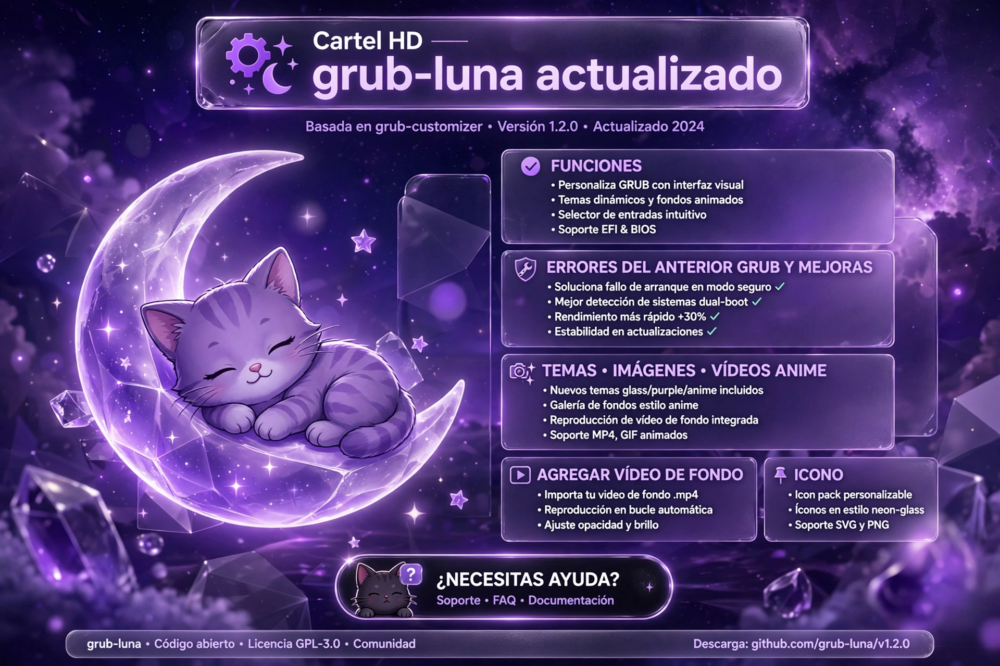

# 🌙 grub-luna v1.0
Personaliza tu GRUB, fácil, sin perderlo nunca.
Basada en grub-customizer solo como información, crédito a Daniel Richter, su autor original.

Hecho por Vega & Kiki / Guzman

## 🔄 Diferencias: GRUB viejo y nuevo
- ❌ Viejo: se perdía el GRUB, había que reinstalar la distro | ✅ Nuevo: un solo botón Restaurar GRUB, queda como nuevo
- ❌ Viejo: pantallas técnicas CFG_DIR, DEVICEMAP_FILE, dolor de cabeza | ✅ Nuevo: sin pantallas técnicas, fácil, sin terminal
- ❌ Viejo: a veces no leía los archivos | ✅ Nuevo: lee todos los archivos de GRUB, verifica y hace copia de seguridad
- ❌ Viejo: interfaz vieja, GTK3 | ✅ Nuevo: interfaz Glass morada, moderna, con barrita Luna
- ❌ Viejo: sin video, sin iconos, sin tienda | ✅ Nuevo: video de fondo, Cambiar iconos con más de 20 estilos, Biblioteca como tienda con Descargar

## 🛠️ Lenguaje y diferencia con grub-customizer

El lenguaje NO es diferente, es el mismo de Luna: Python y tkinter.

**Luna está hecha con:** Python, tkinter (ventana), mpv (fondo), makepkg (paquete Arch), zenity (instalador gráfico).

**grub-luna está hecha con:** Python y tkinter, como Luna, fácil, sin comandos, sin terminal.

**grub-customizer original está hecho con:** C++ y GTK, difícil, con pantallas técnicas.

**Diferencia del programa:**
- grub-customizer: C++, GTK3, pantallas técnicas CFG_DIR y DEVICEMAP_FILE, a veces se pierde el GRUB, hay que reinstalar la distro.
- grub-luna: Python, tkinter, interfaz Glass morada, lee todos los archivos, hace copia de seguridad, Restaurar GRUB con un solo botón, video de fondo, iconos y Biblioteca como tienda.

grub-luna funciona sin perder el GRUB, con un solo botón se restaura como nuevo.

## ✨ Funciones
- 📖 Lee todos los archivos de GRUB
- 📁 Agregar GRUB / Agregar Carpeta
- ➕ Poner fondo + / ❌ Quitar fondo ×
- ↩️ Restaurar GRUB originalmente, con un solo botón
- 🎨 Cambiar iconos, más de 20 estilos, con vista previa
- 🎬 Video como fondo del GRUB
- 📦 Biblioteca: 20 videos, 50 imágenes, 20 iconos, los de anime más descargados, con botón Descargar como tienda KDE
- 🗂️ Tipos: .tar.gz, .tar.xz, .tar, JPG, PNG, WEBP, MP4, MKV
- 🎨 GRUB personalizados de GNOME y KDE Plasma, solo agregar archivo
- 🚫 Sin comandos, sin descomprimir, sin terminal
- 💾 Guardar con copia de seguridad
- ❓ Acerca, con gatito negro y ?, basada, funciones, errores del anterior GRUB y mejoras
- 🆘 Soporte / Ayuda: https://github.com/lunagave/grub-luna
