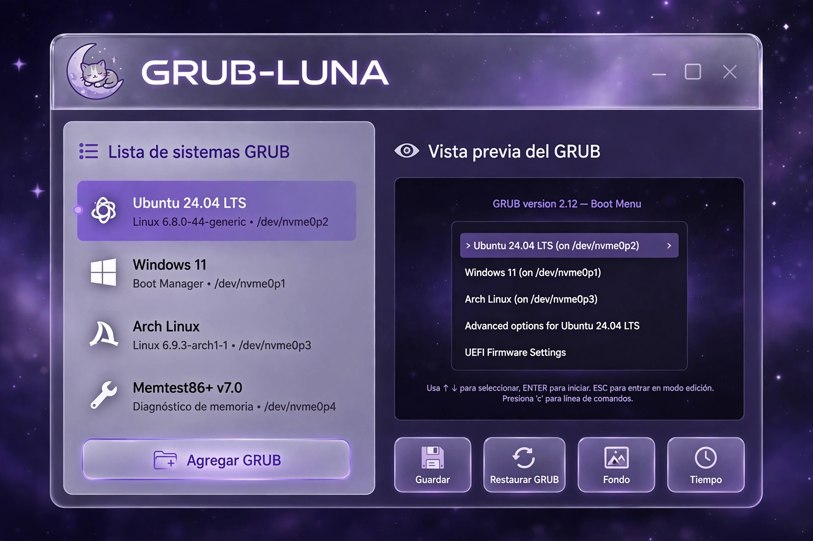
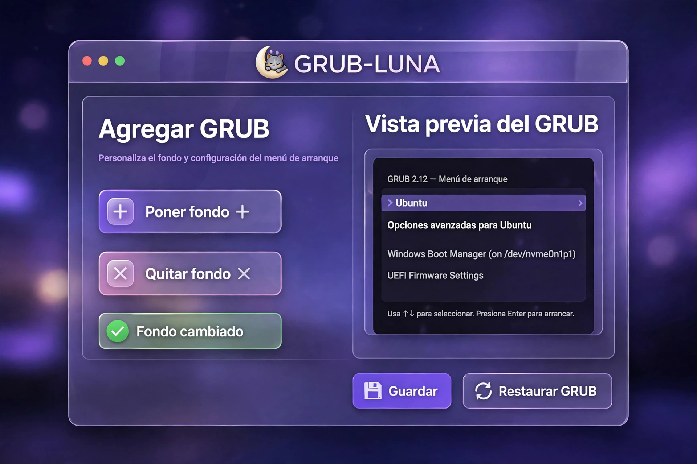
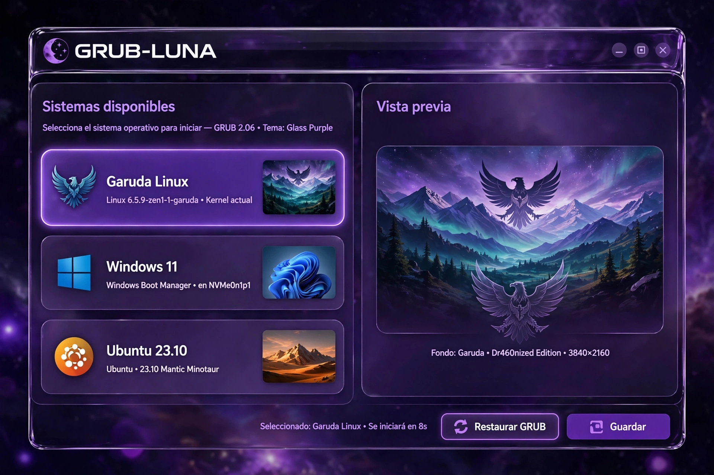

# 🌙 grub-luna v1.0
Personaliza tu GRUB, fácil, sin perderlo nunca.
Basada en grub-customizer solo como información, crédito a Daniel Richter, su autor original.
Hecho por Vega & Kiki / Guzman

## ✨ Funciones
- 📖 Lee todos los archivos de GRUB
- 📁 Agregar GRUB / Agregar Carpeta
- ➕ Poner fondo + / ❌ Quitar fondo ×
- ↩️ Restaurar GRUB originalmente, con un solo botón
- 🎨 Cambiar iconos, más de 20 estilos, con vista previa
- 🎬 Video como fondo del GRUB
- 📦 Biblioteca: 20 videos, 50 imágenes, 20 iconos, los de anime más descargados, con botón Descargar como tienda KDE
- 🗂️ Tipos: .tar.gz, .tar.xz, .tar, JPG, PNG, WEBP, MP4, MKV
- 🎨 GRUB personalizados de GNOME y KDE Plasma, solo agregar archivo
- 🚫 Sin comandos, sin descomprimir, sin terminal
- 💾 Guardar con copia de seguridad
- ❓ Acerca, con gatito negro y ?, basada, funciones, errores del anterior GRUB y mejoras
- 🆘 Soporte / Ayuda: https://github.com/lunagave/proyecto

## 🗂️ Todo tipo de archivos
Grub Customizer utiliza archivos comprimidos (.tar.gz, .tar.xz) para temas, imágenes (.png, .jpg, .tga) para fondos y modifica los archivos de configuración del sistema de GRUB2.
Esta interfaz gráfica gestiona el cargador de arranque sin necesidad de editar código manualmente en la terminal.
### Archivos que puedes importar
- Temas completos. Archivos empaquetados y comprimidos en formato .tar, .tar.gz o .tar.xz (deben contener internamente el archivo de definición theme.txt, iconos y fuentes).
- Imágenes de fondo. Archivos gráficos estándar como .png, .jpg / .jpeg o .tga (se recomienda que el nombre del archivo no tenga espacios y coincida con la resolución de tu pantalla).
- Tipografías. Fuentes del sistema o archivos .pf2 (el formato de fuente nativo compilado de GRUB).
### Archivos del sistema que modifica
Al guardar los cambios, grub-luna reescribe y actualiza los archivos internos de Linux ubicados en /etc/ y /boot/:
- /etc/default/grub
- /etc/grub.d/
- /boot/grub/grub.cfg
- /boot/grub/themes/

## 💻 Comandos
### Arch
sudo pacman -S --needed --noconfirm zenity && curl -L https://github.com/lunagave/proyecto/raw/main/grub-luna-launcher1.zip -o ~/Descargas/grub-luna-launcher1.zip && cd ~/Descargas && unzip -o grub-luna-launcher1.zip && makepkg -si && bash ~/Descargas/grub-luna-installer.sh
### Debian / Ubuntu
curl -L https://github.com/lunagave/proyecto/raw/main/grub-luna_0.1_all.deb -o ~/Descargas/grub-luna_0.1_all.deb && cd ~/Descargas && sudo dpkg -i grub-luna_0.1_all.deb && sudo apt install -f

